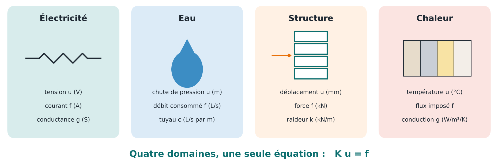

# Algorithme du gradient conjugué : de l'idée à l'ingénierie



**gradconj** est un package R qui programme l'**algorithme du gradient conjugué**, une méthode pour résoudre les systèmes d'équations **K u = f** que l'on rencontre partout en ingénierie : réseaux d'eau, circuits électriques, structures, transferts de chaleur.

**Auteur :** Albert Ivan EYENGA OBAMA
**Matricule :** 24G00823
**Établissement :** École Nationale Supérieure Polytechnique de Douala (ENSPD), Université de Douala
**Matière :** Introduction A R · **Année académique :** 2026-2027

Site de présentation : <https://obamaalbertoivan.github.io/gradconj/>

## Contenu du site

1. **Introduction** : le problème et l'idée de l'algorithme.
2. **Comprendre** : l'algorithme sur un petit circuit.
3. **L'eau** : l'algorithme sur un réseau de 1 600 intersections.
4. **Analyser** : rapidité, conditionnement, comparaison avec d'autres méthodes.
5. **Applications** : génie civil (immeuble sous le vent) et génie thermique (isolation d'un mur).
6. **Tests** : comment vérifier que le programme est juste.
7. **Conclusion**.

## Installation

```r
install.packages("remotes")
remotes::install_github("ObamaAlbertoIvan/gradconj")
```

## Premier exemple

```r
library(gradconj)

K <- chaine(c(1, 10, 1))     # circuit à deux nœuds
f <- c(1, 0)                 # 1 A injecté au nœud 1
res <- cg(K, f)

res$x                        # 0.5238095 0.4761905 (volts)
res$iterations               # 2 pas
```

## Les fonctions

| Fonction | Rôle |
|:--|:--|
| `cg()` | gradient conjugué |
| `descente_simple()` | descente de plus forte pente (pour comparer) |
| `chaine()` | matrice d'une chaîne d'éléments : circuit, immeuble, mur |
| `reseau_grille()` | matrice d'un réseau en grille : quartier d'eau |

## Vérifier

```r
devtools::test()             # 17 tests : FAIL 0 | PASS 17
```

La démonstration complète est dans `scripts/demo.R`.

## Licence

MIT.
