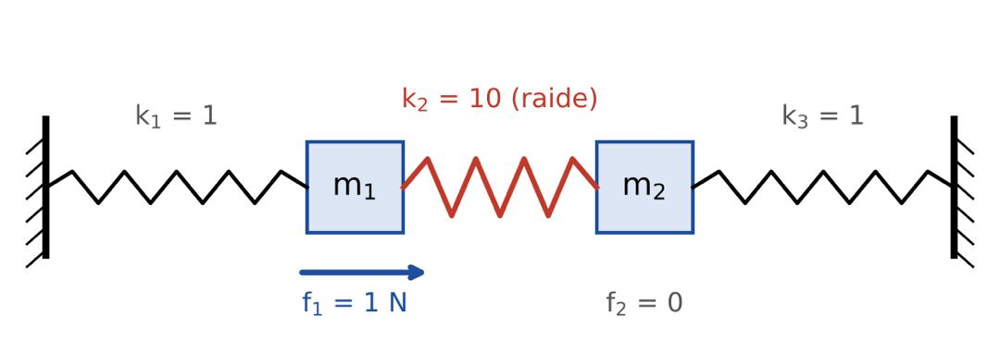

# Le gradient conjugué


**La question.** Si on pousse ces masses, où s'arrêtent-elles ?
Répondre revient à résoudre un système d'équations.
**Le plan.** 1. Comprendre · 2. Analyser · 3. Appliquer · 4. Package R

## Installation
```r
install.packages("remotes")
remotes::install_github("ObamaAlbertoIvan/gradconj")
```
## Exemple
```r
library(gradconj)
K <- matrix(c(11, -10, -10, 11), nrow = 2)   # deux masses, ressort central raide
cg(K, c(1, 0))$x                             # 0.5238095 0.4761905

