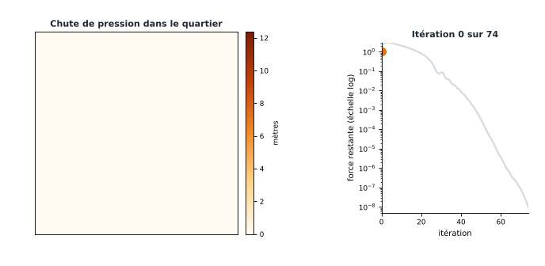

# gradconj : le gradient conjugué, de l'idée à l'ingénierie


**gradconj** est un package R qui programme le **gradient conjugué**, une méthode pour résoudre les systèmes d'équations **K u = f** que l'on rencontre partout en ingénierie : réseaux d'eau, circuits électriques, structures, transferts de chaleur.

Projet de recherche, ENSPD, Université de Douala. Auteur : Albert Ivan Eyenga Obama.



## Le parcours (site web)

Le site est organisé comme l'exposé :

1. **Comprendre** : un circuit à deux nœuds, l'idée du bol d'énergie, l'algorithme en quatre idées.
2. **L'eau** : un second exemple, le réseau de distribution d'un quartier de 1 600 intersections.
3. **Analyser** : vitesse de convergence, conditionnement, comparaison honnête avec les autres méthodes.
4. **Applications** : hydraulique, génie civil, génie thermique, génie électrique.
5. **Tests** : comment vérifier soi-même que le programme est juste.

## Installation

```r
install.packages("remotes")
remotes::install_github("ObamaAlbertoIvan/gradconj")
```

## Premier exemple

```r
library(gradconj)

K <- chaine(c(1, 10, 1))     # circuit : trois résistances, deux nœuds
f <- c(1, 0)                 # 1 A injecté au nœud 1
res <- cg(K, f)

res$x                        # 0.5238095 0.4761905 (volts)
res$iterations               # 2 pas
```

## Les fonctions

| Fonction | Rôle |
|:--|:--|
| `cg()` | gradient conjugué |
| `descente_simple()` | descente de plus forte pente (pour comparer) |
| `chaine()` | matrice d'une chaîne de nœuds : circuit, immeuble, mur |
| `reseau_grille()` | matrice d'un réseau en grille : quartier d'eau |

## Vérifier

```r
devtools::test()             # 17 tests : FAIL 0 | PASS 17
```

La démonstration complète est dans `scripts/demo.R`.

## Licence

MIT.
