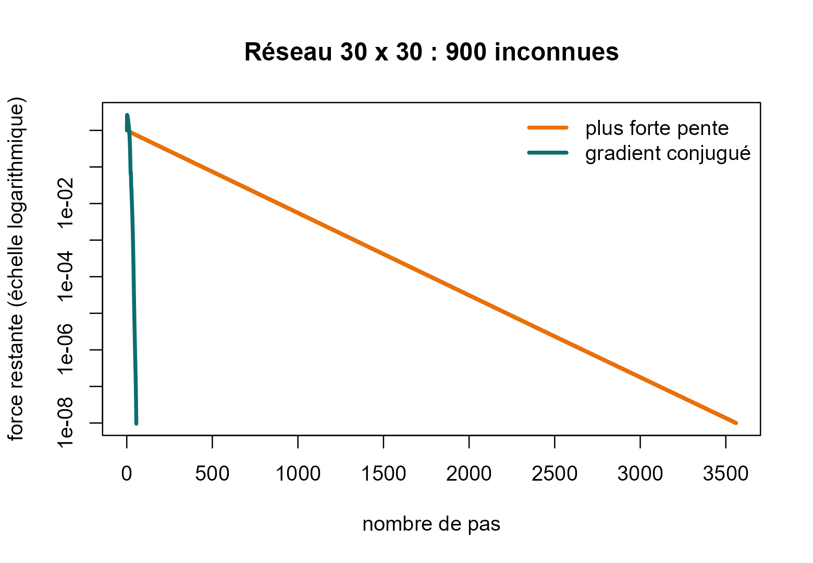

# 3. Analyser l'algorithme

**Dans cette page, vous allez :**

- mesurer la rapidité de l’algorithme et la comparer à la plus forte
  pente ;
- comprendre **pourquoi** il est plus rapide, grâce au conditionnement ;
- voir quand il est le bon choix, et quand il ne l’est pas.

Les deux pages précédentes montraient que l’algorithme **fonctionne**,
sur un petit circuit puis sur un grand réseau. Ici, on se demande :
**est-il vraiment efficace, et pourquoi ?**

## 1. La rapidité

On résout un réseau d’eau de 30 × 30 intersections (900 inconnues) avec
les deux méthodes, et on suit la **force restante** à chaque pas.

``` r

N <- 30
A <- reseau_grille(N)
f <- rep(0.01, N * N)

a <- cg(A, f)
b <- descente_simple(A, f)

c(gradient_conjugue = a$iterations, plus_forte_pente = b$iterations)
```

    ## gradient_conjugue  plus_forte_pente 
    ##                55              3559

``` r

plot(b$historique / b$historique[1], type = "l", log = "y", col = "#E8710A", lwd = 3,
     xlab = "nombre de pas", ylab = "force restante (échelle logarithmique)",
     main = "Réseau 30 x 30 : 900 inconnues")
lines(a$historique / a$historique[1], col = "#0B6E6E", lwd = 3)
legend("topright", c("plus forte pente", "gradient conjugué"),
       col = c("#E8710A", "#0B6E6E"), lwd = 3, bty = "n")
```



**Comment lire ce graphique.** L’axe horizontal compte les pas. L’axe
vertical montre la force restante : plus elle est basse, plus on est
proche de la solution. Il est en échelle logarithmique : chaque
graduation est 10 fois plus petite que la précédente, ce qui permet de
voir une grandeur qui passe de 1 à 0,00000001. Plus la courbe descend
vite, meilleure est la méthode.

**Résultat :** le gradient conjugué atteint la précision demandée en
**55 pas**, la plus forte pente en **3 559**. C’est 65 fois moins de pas
pour la même réponse.

## 2. Pourquoi ? Le conditionnement

Souvenons-nous du bol d’énergie. Un bol peut être **rond** ou
**allongé** comme une vallée étroite.

- Dans un bol **rond**, la plus forte pente pointe droit vers le fond :
  très peu de pas.
- Dans un bol **allongé**, elle pointe vers le flanc : on zigzague,
  beaucoup de pas.

Le **conditionnement**, noté κ, mesure à quel point le bol est allongé.
C’est le rapport entre sa plus grande et sa plus petite « raideur »,
obtenues avec [`eigen()`](https://rdrr.io/r/base/eigen.html) (les
valeurs propres de K).

``` r

K <- chaine(c(1, 10, 1))        # le circuit de la page 1
valeurs <- eigen(K)$values
valeurs                          # la plus grande et la plus petite raideur
```

    ## [1] 21  1

``` r

max(valeurs) / min(valeurs)      # le conditionnement
```

    ## [1] 21

Pour notre circuit, κ = 21 / 1 = **21**.

| Conditionnement κ | Forme du bol   | Difficulté |
|:------------------|:---------------|:-----------|
| proche de 1       | rond           | facile     |
| grand             | vallée étroite | difficile  |

Le point important est la façon dont le nombre de pas dépend de κ :

- **plus forte pente** : le nombre de pas est proportionnel à **κ** ;
- **gradient conjugué** : il est proportionnel à **√κ** (la racine
  carrée de κ).

Pour κ = 10 000, cela fait de l’ordre de 10 000 pas pour la plus forte
pente, contre 100 pour le gradient conjugué. Plus le problème est
difficile, plus l’écart se creuse.

Un autre résultat de la théorie : en calcul exact, le gradient conjugué
termine en **au plus n pas** pour n inconnues. C’est ce que l’on a vu :
2 pas pour 2 inconnues, 3 pas pour les 9 inconnues du petit réseau.

## 3. Une comparaison honnête

Le gradient conjugué n’est pas la meilleure méthode partout.

| Situation | Meilleur choix |
|:---|:---|
| Petit système | n’importe quelle méthode ; [`solve()`](https://rdrr.io/r/base/solve.html) est très bien |
| Grand système creux, problème plan (2D) | méthode directe pour matrices creuses et gradient conjugué sont proches |
| Très grand système, problème en volume (3D) | **gradient conjugué** : il utilise peu de mémoire |
| Même matrice, **beaucoup de seconds membres** | méthode directe : on prépare la matrice une seule fois |
| Une réponse approchée suffit | **gradient conjugué** : on s’arrête quand la précision est suffisante |

## 4. Les limites

- La matrice K doit être **symétrique définie positive**. Sinon, on
  utilise d’autres méthodes (GMRES, BiCGStab).
- Quand κ est très grand, l’algorithme ralentit. Le remède s’appelle le
  **préconditionnement** : on transforme le système pour rendre le bol
  plus rond. Il n’est pas programmé dans ce package : c’est la suite
  naturelle du travail.
- À cause des arrondis de l’ordinateur, on s’arrête sur un **critère de
  précision** plutôt que sur le nombre de pas.

**À retenir.** Le gradient conjugué est bien plus rapide que la plus
forte pente parce que son nombre de pas dépend de √κ et non de κ. Il est
idéal pour les grands systèmes creux, sans être la meilleure méthode
dans tous les cas.

**Suite :** [4. Applications en
ingénierie](https://obamaalbertoivan.github.io/gradconj/articles/appliquer.md)
