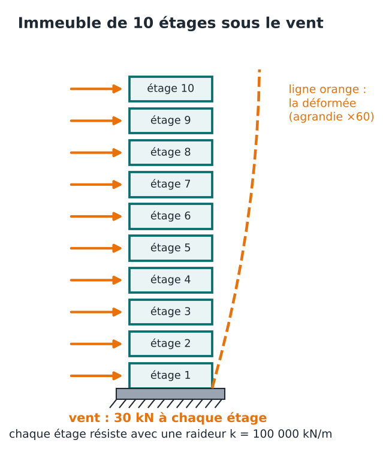
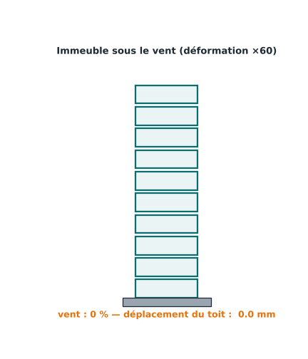
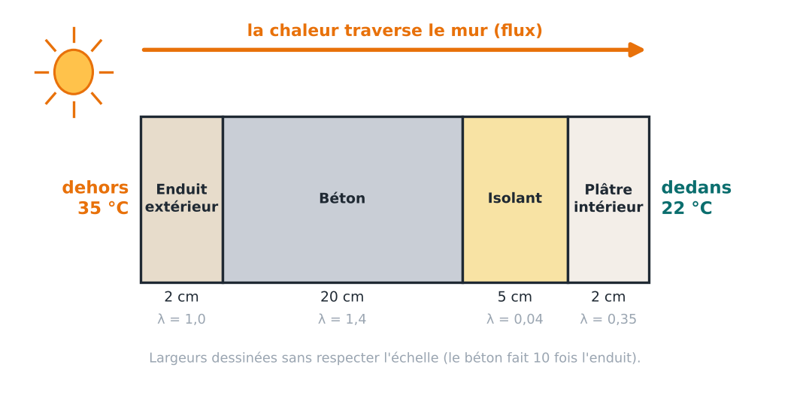
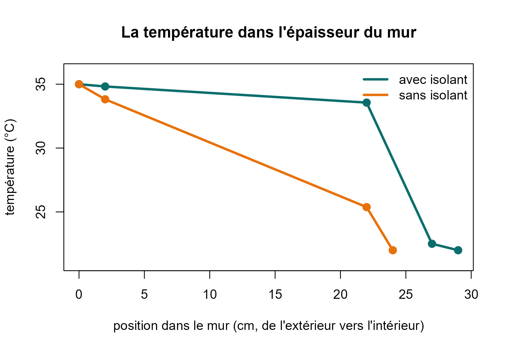

# 4. Applications en ingénierie

**Deux problèmes d’ingénieur, résolus avec l’algorithme :**

1.  **Génie civil** : un immeuble de 10 étages sous le vent.
2.  **Génie thermique** : faut-il isoler un mur ?

Dans chaque cas, la démarche est la même : **poser la question**,
**modéliser** (écrire K et f), **résoudre** avec
[`cg()`](https://obamaalbertoivan.github.io/gradconj/reference/cg.md),
puis **interpréter** le résultat pour prendre une décision.

Les deux applications précédentes ont déjà montré le **génie
électrique** (le circuit de la page 1) et l’**hydraulique** (le réseau
d’eau de la page 2). Voici deux domaines de plus, traités en détail.

## Génie civil : un immeuble sous le vent

### La question

Le vent pousse sur un immeuble de 10 étages. **De combien l’immeuble se
déforme-t-il ?** Si la déformation entre deux étages est trop grande,
les cloisons fissurent et les vitres cassent. L’ingénieur doit le
vérifier avant de construire.

### Le modèle

On représente l’immeuble par des **ressorts empilés** : chaque étage est
retenu par l’étage du dessous, comme par un ressort.



- **u** : le déplacement horizontal de chaque étage (ce qu’on cherche) ;
- **f** : la force du vent sur chaque étage : 30 kN ;
- **K** : décrit les ressorts. Chaque étage a une **raideur** de 100 000
  kN/m : la force qu’il faut pour le déformer d’un mètre.

C’est exactement le même raisonnement que pour le circuit. Pour un
étage, la loi s’écrit : *la force du vent est égale à la force que
transmettent les ressorts du dessous et du dessus*. La raideur joue le
rôle de la conductance, le déplacement joue le rôle de la tension, la
force joue le rôle du courant. On peut donc réutiliser
[`chaine()`](https://obamaalbertoivan.github.io/gradconj/reference/chaine.md).

Le **0 à la fin** de la liste dit qu’il n’y a rien au-dessus du toit
pour le retenir.

``` r

k <- rep(1e5, 10)            # la raideur de chaque étage (kN/m)
A <- chaine(c(k, 0))         # la matrice K : le 0 final = le toit n'est retenu par rien d'autre
vent <- rep(30, 10)          # 30 kN de vent sur chaque étage

res <- cg(A, vent)
u <- res$x * 1000            # on passe des mètres aux millimètres
round(u, 1)                  # déplacement de chaque étage (mm)
```

    ##  [1]  3.0  5.7  8.1 10.2 12.0 13.5 14.7 15.6 16.2 16.5

### Les résultats

Le déplacement augmente avec la hauteur : le **toit bouge de 16,5 mm**.
Mais ce qui casse les cloisons n’est pas le déplacement total : c’est la
**dérive**, c’est-à-dire de combien un étage bouge **par rapport à celui
du dessous**.

``` r

derive <- diff(c(0, u))      # déplacement d'un étage moins celui du dessous
round(derive, 1)             # dérive de chaque étage (mm)
```

    ##  [1] 3.0 2.7 2.4 2.1 1.8 1.5 1.2 0.9 0.6 0.3

La dérive est maximale au **rez-de-chaussée (3 mm)**. Pourquoi ? Parce
que le premier étage doit retenir la poussée de **tous les étages
au-dessus**. Plus on monte, moins il y a d’étages à retenir : la dérive
diminue.

``` r

plot(c(0, u), 0:10, type = "o", pch = 19, lwd = 3, col = "#0B6E6E",
     xlab = "déplacement horizontal (mm)", ylab = "étage",
     main = "Déformée de l'immeuble")
```




### Et si un étage est plus souple ?

Imaginons que le 5e étage ait de grandes baies vitrées : sa raideur
tombe à 40 % de celle des autres.

``` r

k2 <- k
k2[5] <- 0.4 * 1e5
res2 <- cg(chaine(c(k2, 0)), vent)
derive2 <- diff(c(0, res2$x * 1000))
round(derive2, 1)            # dérive de chaque étage (mm)
```

    ##  [1] 3.0 2.7 2.4 2.1 4.5 1.5 1.2 0.9 0.6 0.3

À l’étage 5, la dérive passe de **1,8 mm à 4,5 mm**, et le toit passe à
**19,2 mm**. Un étage souple **concentre la déformation** : il se
déforme beaucoup plus, car il est le maillon faible de la chaîne.

### La décision

Il faut éviter les étages « mous » : un étage plus souple concentre la
déformation et peut dépasser la limite de dérive fixée par la norme (la
valeur se trouve dans votre cours). Le calcul permet de le voir
**avant** de construire, et de renforcer l’étage concerné.

## Génie thermique : faut-il isoler un mur ?

### La question

Il fait **35 °C dehors** et **22 °C dedans** (climatisation). Un mur
sépare les deux. **Quelle quantité de chaleur le traverse ?** Et un
isolant de 5 cm change-t-il vraiment les choses ? Cette chaleur doit
être évacuée par la climatisation : plus elle est grande, plus on
consomme d’électricité.

### Le modèle

Le mur est fait de **couches** : enduit, béton, isolant, plâtre (de
l’extérieur vers l’intérieur).



La chaleur traverse chaque couche comme le courant traverse un fil.
Chaque couche a une **conductance** : elle laisse plus ou moins passer
la chaleur. Elle se calcule avec

``` math
\text{conductance} = \frac{\lambda}{\text{épaisseur}}
```

où λ est la conductivité thermique du matériau (grande pour le béton,
minuscule pour un isolant).

| Circuit électrique | Mur                 |
|:-------------------|:--------------------|
| tension            | **température**     |
| courant            | **flux de chaleur** |
| fil                | **couche**          |

Les inconnues sont les températures aux **interfaces** entre les
couches. Les températures extérieure et intérieure sont imposées : elles
entrent dans le second membre.

``` r

mur <- function(e, lam, T_ext = 35, T_int = 22) {
  g <- lam / e                     # conductance de chaque couche
  n <- length(g) - 1               # nombre d'interfaces entre deux couches
  b <- rep(0, n)
  b[1] <- g[1] * T_ext             # la première couche touche l'extérieur (35 °C)
  b[n] <- b[n] + g[n + 1] * T_int  # la dernière touche l'intérieur (22 °C)
  T_inter <- cg(chaine(g), b)$x    # on résout : températures aux interfaces
  list(T = c(T_ext, T_inter, T_int),
       position = cumsum(c(0, e)) * 100,        # position dans le mur (cm)
       flux = g[1] * (T_ext - T_inter[1]))      # chaleur qui traverse le mur
}
```

### Les résultats

On calcule d’abord le mur isolé, puis le même mur **sans la couche
d’isolant**.

``` r

e   <- c(0.02, 0.20, 0.05, 0.02)    # épaisseurs : enduit, béton, isolant, plâtre (m)
lam <- c(1.0, 1.4, 0.04, 0.35)      # conductivité thermique de chaque matériau

avec <- mur(e, lam)
sans <- mur(e[-3], lam[-3])         # on retire la couche n°3 (l'isolant)

c(avec_isolant = avec$flux, sans_isolant = sans$flux)    # chaleur en W par m2
```

    ## avec_isolant sans_isolant 
    ##     8.843537    59.090909

L’isolant fait passer le flux de **59 W/m² à 8,8 W/m²** : **85 % de
chaleur en moins**. Pour un mur de 20 m², la climatisation doit évacuer
177 W au lieu de 1 182 W.

``` r

plot(avec$position, avec$T, type = "o", pch = 19, lwd = 3, col = "#0B6E6E", ylim = c(21, 36),
     xlab = "position dans le mur (cm, de l'extérieur vers l'intérieur)",
     ylab = "température (°C)", main = "La température dans l'épaisseur du mur")
lines(sans$position, sans$T, type = "o", pch = 19, lwd = 3, col = "#E8710A")
legend("topright", c("avec isolant", "sans isolant"), col = c("#0B6E6E", "#E8710A"),
       lwd = 3, bty = "n")
```



**Comment lire ce graphique.** Chaque point est une interface entre deux
couches. **Avec isolant** (vert), la température reste entre 34,8 et
33,6 °C jusqu’au béton, puis **chute de 33,6 à 22,5 °C dans l’isolant
seul**. C’est la couche isolante qui « porte » presque tout l’écart de
température : elle bloque la chaleur. **Sans isolant** (orange), c’est
le béton qui absorbe la baisse (de 33,8 à 25,4 °C), mais il laisse
passer beaucoup plus de chaleur : le flux est 6 fois plus grand.

### La décision

Isoler divise la chaleur qui traverse le mur par plus de 6, avec
seulement 5 cm de matériau. Le calcul chiffre ce gain **avant** de
choisir les matériaux : il aide à décider de l’épaisseur d’isolant à
prévoir, en fonction de la consommation de climatisation que l’on veut
atteindre.

## Et dans d’autres domaines ?

Le même principe sert dès qu’une quantité se répartit dans un réseau ou
un milieu : écoulement d’eau dans le sol (géotechnique), potentiel
électrique (électrostatique), éléments finis en mécanique des
structures, traitement d’image, statistiques (moindres carrés). Dans les
logiciels d’éléments finis, les systèmes dépassent le million
d’inconnues : c’est là que le gradient conjugué devient indispensable.

**Suite :** [5. Les
tests](https://obamaalbertoivan.github.io/gradconj/articles/validation.md)
