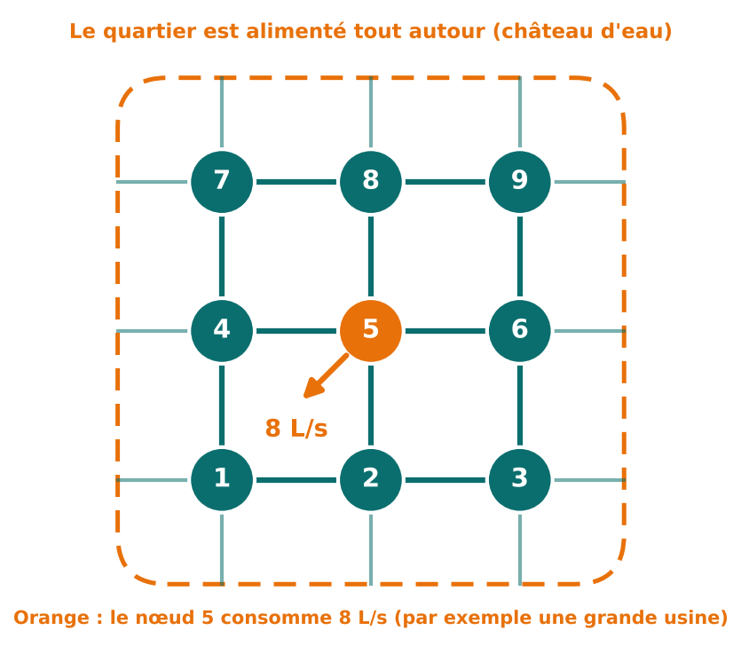
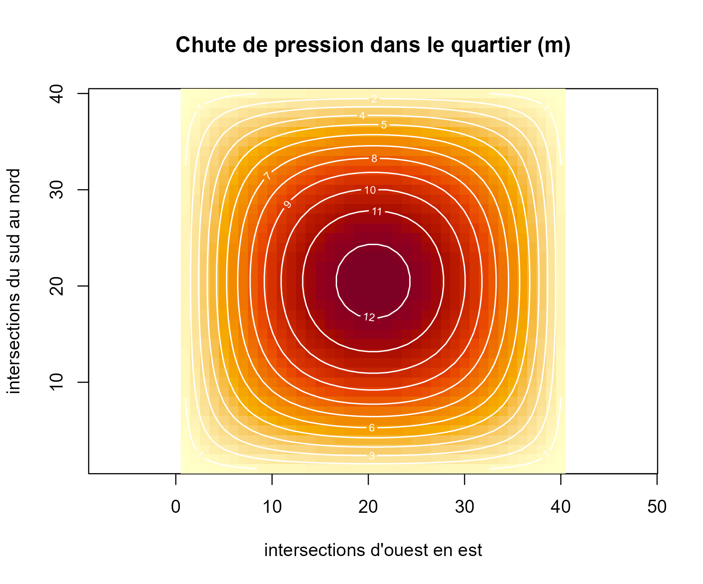

# 2. Un deuxième exemple : l'eau d'un quartier

**Dans cette page, vous allez voir :**

- que la même méthode calcule les **pressions d’un réseau d’eau** ;
- un petit exemple de 9 intersections, que l’on lit à la main ;
- un quartier de **1 600 intersections**, résolu en une fraction de
  seconde ;
- pourquoi l’algorithme convient bien aux grands réseaux.

## Du circuit au réseau d’eau

Dans la page précédente, nous avions 2 inconnues. Ici, nous passons à un
problème bien plus grand, mais le **raisonnement est identique**. Seuls
les mots changent :

| Circuit électrique | Réseau d’eau |
|:---|:---|
| tension | chute de pression |
| courant injecté | débit consommé |
| fil | tuyau |
| loi des nœuds | l’eau qui arrive à une intersection est égale à l’eau qui en repart |

## La situation

Un quartier est alimenté par un château d’eau. Les tuyaux forment une
**grille**. À chaque intersection, des habitants consomment de l’eau.
Plus on est loin de l’alimentation, plus la pression baisse.

L’ingénieur veut savoir : **de combien la pression chute-t-elle à chaque
intersection ?** Si elle chute trop, l’eau n’arrive plus aux étages
élevés.

## Le modèle

Chaque intersection est reliée à ses **4 voisins** (haut, bas, gauche,
droite). Les intersections du bord sont aussi reliées à l’alimentation,
où la chute de pression est nulle.

On écrit, comme pour le circuit, l’équation de chaque intersection. Cela
donne une ligne du tableau K avec :

- un **4** sur la diagonale (les 4 tuyaux qui touchent l’intersection) ;
- un **−1** pour chacun des 4 voisins ;
- des **zéros** partout ailleurs (pas de tuyau direct).

Les inconnues u sont les chutes de pression (en mètres). Le second
membre f contient les débits consommés (en L/s). La fonction
[`reseau_grille()`](https://obamaalbertoivan.github.io/gradconj/reference/reseau_grille.md)
construit K.

## Un petit exemple : 3 × 3 intersections

Au centre (intersection 5), une usine consomme **8 L/s**. Les autres
intersections ne consomment rien.



``` r

A <- reseau_grille(3)
as.matrix(A)       # le tableau K, 9 lignes et 9 colonnes
```

    ##       [,1] [,2] [,3] [,4] [,5] [,6] [,7] [,8] [,9]
    ##  [1,]    4   -1    0   -1    0    0    0    0    0
    ##  [2,]   -1    4   -1    0   -1    0    0    0    0
    ##  [3,]    0   -1    4    0    0   -1    0    0    0
    ##  [4,]   -1    0    0    4   -1    0   -1    0    0
    ##  [5,]    0   -1    0   -1    4   -1    0   -1    0
    ##  [6,]    0    0   -1    0   -1    4    0    0   -1
    ##  [7,]    0    0    0   -1    0    0    4   -1    0
    ##  [8,]    0    0    0    0   -1    0   -1    4   -1
    ##  [9,]    0    0    0    0    0   -1    0   -1    4

Regardons la **ligne 5**, celle du centre : un 4 au milieu, et −1 pour
les intersections 2, 4, 6 et 8, ses quatre voisins. Les zéros disent «
pas de tuyau direct ».

``` r

f <- c(0, 0, 0, 0, 8, 0, 0, 0, 0)    # l'usine est à l'intersection 5
res <- cg(A, f)
matrix(res$x, nrow = 3)              # on remet les 9 valeurs en carré 3 x 3
```

    ##      [,1] [,2] [,3]
    ## [1,]  0.5    1  0.5
    ## [2,]  1.0    3  1.0
    ## [3,]  0.5    1  0.5

On lit : **3 m** au centre, **1 m** pour les quatre voisins, **0,5 m**
dans les coins. La chute est maximale là où l’on consomme, et elle
diminue en s’éloignant. C’est conforme à l’intuition : le résultat est
cohérent.

## Un vrai quartier : 40 × 40 intersections

Passons à **1 600 intersections**, chacune consommant 0,1 L/s (les
habitations). Cela fait 1 600 équations à 1 600 inconnues.

``` r

N <- 40
A <- reseau_grille(N)
f <- rep(0.1, N * N)
res <- cg(A, f)

res$iterations     # nombre de pas
```

    ## [1] 74

``` r

max(res$x)         # la plus forte chute de pression (m)
```

    ## [1] 12.36586

**74 pas** suffisent pour 1 600 inconnues. Voici la carte des pressions
:

``` r

image(1:N, 1:N, matrix(res$x, N), col = hcl.colors(60, "YlOrRd", rev = TRUE),
      xlab = "intersections d'ouest en est", ylab = "intersections du sud au nord",
      main = "Chute de pression dans le quartier (m)", asp = 1)
contour(1:N, 1:N, matrix(res$x, N), add = TRUE, col = "white", lwd = 1.2)
```



Plus la zone est foncée, plus la pression chute. Le **centre est le
point faible** : c’est le plus loin de l’alimentation, qui entoure le
quartier. Au bord, la chute est presque nulle. Les traits blancs relient
les points de même chute de pression.


L’animation montre la solution se construire : l’algorithme trouve
d’abord la forme générale, puis affine.

## Pourquoi l’algorithme convient ici

- Le tableau K est **creux** : chaque ligne n’a que 5 valeurs non nulles
  sur 1 600. On ne mémorise que celles-là.
- L’algorithme n’a besoin que de **multiplier K par une liste de
  nombres**, ce qui est très rapide sur un tableau creux.
- Pour un réseau de centaines de milliers d’intersections, les méthodes
  qui traitent tout le tableau deviennent trop lourdes.

**Limite du modèle.** Tous les tuyaux ont ici la même conductance et les
pertes de pression sont supposées proportionnelles au débit. Un vrai
calcul de réseau tient compte des diamètres, des pompes et des vannes.
On retrouve toutefois ce même type de système à l’intérieur des
logiciels professionnels.

**Suite :** [3. Analyser
l’algorithme](https://obamaalbertoivan.github.io/gradconj/articles/analyser.md)
