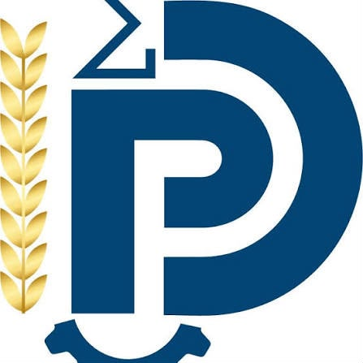

**École Nationale Supérieure Polytechnique de Douala**\
Université de Douala

Introduction A R

Algorithme du gradient conjugué

De l’idée à l’ingénierie : un package R

Présenté par **Albert Ivan EYENGA OBAMA**

Matricule : 24G00823

Encadrant : M. Ngneumeu Ivan

Année académique 2026-2027

[Entrer dans le site
→](https://obamaalbertoivan.github.io/gradconj/articles/sommaire.md)
