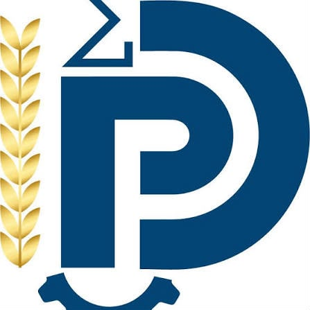

<!-- debut-couverture -->

<b>École Nationale Supérieure Polytechnique de Douala</b> Université de Douala

Introduction A R

Algorithme du gradient conjugué

De l'idée à l'ingénierie : un package R

Présenté par <b>Albert Ivan EYENGA OBAMA</b>

Matricule : 24G00823

Encadrant : M. Ngneumeu Ivan

Année académique 2026-2027

<a href='articles/sommaire.html' style='background:#0B6E6E;color:#ffffff;padding:12px 28px;border-radius:6px;text-decoration:none;font-size:1.1rem'>Entrer dans le site &rarr;</a>

<!-- fin-couverture -->
